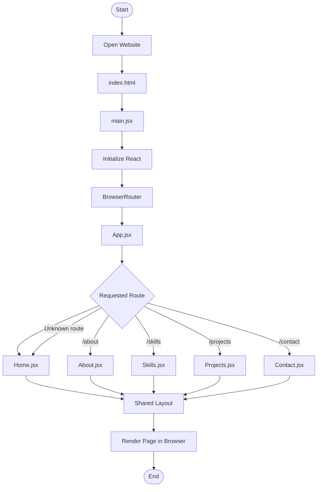
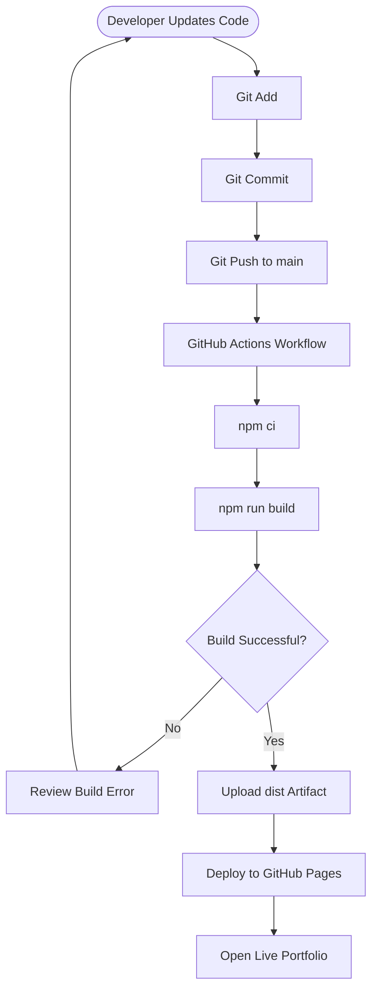

# Portfolio Website — Tushar Mahajan

A personal portfolio website built with **React.js, Vite, React Router DOM, Bootstrap 5, and CSS**. This project showcases my profile, skills, projects, and contact information in a responsive website.

## 🌐 Live Demo

**Portfolio Website:** https://tusharmahajan737-max.github.io/Protfolio/

**GitHub Repository:** https://github.com/tusharmahajan737-max/Protfolio

## 📌 Table of Contents

- [About the Project](#-about-the-project)
- [Features](#-features)
- [Technologies Used](#-technologies-used)
- [Project Structure](#-project-structure)
- [Application Flowchart](#-application-flowchart)
- [React Router Configuration](#-react-router-configuration)
- [Installation and Setup](#-installation-and-setup)
- [Run the Project](#-run-the-project)
- [Build for Production](#-build-for-production)
- [Deployment on GitHub Pages](#-deployment-on-github-pages)
- [Available Routes](#-available-routes)
- [Future Improvements](#-future-improvements)
- [Author](#-author)

## 📖 About the Project

This portfolio website is designed to present my background as a Computer Science graduate and aspiring web developer.

It organizes personal and professional information into separate pages, making it easy for visitors to explore my profile, technical skills, projects, and contact details.

The application uses React components for reusable UI, React Router DOM for page navigation, Bootstrap for responsive styling, and Vite for development and production builds.

## ✨ Features

- **Home Page:** Introduction and portfolio landing page.
- **About Page:** Personal and educational information.
- **Skills Page:** Technical skills and areas of knowledge.
- **Projects Page:** Showcase of development projects.
- **Contact Page:** Contact information.
- **Client-side Routing:** Navigate between pages using React Router DOM.
- **Responsive Layout:** Bootstrap-based styling for different screen sizes.
- **Reusable Components:** Shared layout for consistent page structure.
- **Production Build:** Optimized static files generated with Vite.
- **GitHub Pages Deployment:** Hosting for the production website.

## 🛠️ Technologies Used

| Technology | Purpose |
|---|---|
| HTML5 | Website structure |
| CSS3 | Custom styling |
| JavaScript (ES6+) | Application logic |
| React.js | Component-based UI |
| Vite | Development server and build tool |
| React Router DOM | Page navigation |
| Bootstrap 5 | Responsive layout and styling |
| Font Awesome | Icons |
| Git | Version control |
| GitHub | Source code hosting |
| GitHub Actions | Automated deployment workflow |
| GitHub Pages | Website hosting |

## 📂 Project Structure

```text
Protfolio/
│
├── public/
│   └──                    # Public assets, if present
│
├── src/
│   ├── components/
│   │   └── Layout.jsx     # Shared application layout
│   │
│   ├── pages/
│   │   ├── Home.jsx       # Home page
│   │   ├── About.jsx      # About page
│   │   ├── Skills.jsx     # Skills page
│   │   ├── Projects.jsx   # Projects page
│   │   └── Contact.jsx    # Contact page
│   │
│   ├── App.jsx            # Application routes
│   ├── main.jsx           # React entry point
│   └── index.css          # Global styles
│
├── .github/
│   └── workflows/
│       └── deploy.yml     # GitHub Actions deployment workflow
│
├── index.html             # HTML entry point
├── package.json           # Dependencies and npm scripts
├── package-lock.json      # Locked dependency versions
├── vite.config.js         # Vite configuration
├── .gitignore             # Files excluded from Git
└── README.md              # Project documentation
```

*Note: This is the documented project structure based on the application files. Keep only folders and files that actually exist in your local project.*

## 🔄 Application Flowchart

The following flowchart explains how the application starts, loads its layout, and displays the requested page.



### Deployment Flowchart



## 🧭 React Router Configuration

The application uses `BrowserRouter` in `src/main.jsx` to enable client-side navigation.

The routes are defined in `src/App.jsx`:

| Route | Page Component | Purpose |
|---|---|---|
| `/` | `Home.jsx` | Home page |
| `/about` | `About.jsx` | About information |
| `/skills` | `Skills.jsx` | Technical skills |
| `/projects` | `Projects.jsx` | Project showcase |
| `/contact` | `Contact.jsx` | Contact information |

The shared `Layout.jsx` component provides the common structure for these routes.

## 💻 Installation and Setup

### Prerequisites

Install the following tools:

- Node.js
- npm
- Git
- A code editor such as Visual Studio Code

### 1. Clone the Repository

```bash
git clone https://github.com/tusharmahajan737-max/Protfolio.git
```

### 2. Navigate to the Project Folder

```bash
cd Protfolio
```

### 3. Install Dependencies

```bash
npm install
```

## ▶️ Run the Project

Start the Vite development server:

```bash
npm run dev
```

Open the local URL shown in your terminal, usually:

```text
http://localhost:5173/
```

## 🏗️ Build for Production

Generate the production build:

```bash
npm run build
```

Vite creates the optimized website files in the `dist/` directory.

To preview the production build locally:

```bash
npm run preview
```

## 🚀 Deployment on GitHub Pages

This project can be deployed to GitHub Pages using GitHub Actions.

### Step 1: Configure Vite

In `vite.config.js`, use the repository name as the base path:

```javascript
import { defineConfig } from 'vite';
import react from '@vitejs/plugin-react';

export default defineConfig({
    plugins: [react()],
    base: '/Protfolio/',
});
```

**Important:** The repository name is `Protfolio`, so the base path must match that spelling and capitalization.

### Step 2: Build the Application

```bash
npm run build
```

### Step 3: Commit and Push Changes

```bash
git add .
git commit -m "docs: update portfolio README"
git push origin main
```

### Step 4: Verify Deployment

1. Open the [GitHub Actions page](https://github.com/tusharmahajan737-max/Protfolio/actions).
2. Wait for the deployment workflow to complete successfully.
3. If it fails, open the workflow run and inspect the error logs.
4. Check the repository's **Settings → Pages** to verify the deployment configuration.
5. Visit the live website:

   https://tusharmahajan737-max.github.io/Protfolio/

### Troubleshooting: 404 Errors

If JavaScript or CSS files return a 404 error:

- Verify that `base` in `vite.config.js` is `/Protfolio/`.
- Confirm that the latest changes have been pushed to the `main` branch.
- Check that the GitHub Actions deployment completed successfully.
- Confirm that the workflow publishes the `dist/` directory.
- Hard-refresh the browser using `Ctrl + Shift + R`.

## 🗺️ Available Routes

The portfolio provides the following pages:

- **Home:** Introduction and landing page.
- **About:** Background and education.
- **Skills:** Technical knowledge.
- **Projects:** Development work and project details.
- **Contact:** Contact section.

## 🔮 Future Improvements

Potential improvements for future versions include:

- Add a downloadable resume.
- Include project screenshots and live project links.
- Add a working contact form.
- Improve accessibility and SEO.
- Add animations and interactive elements.
- Add a dark mode option.
- Expand the portfolio with internship and certification details.

## 👨‍💻 Author

**Tushar Mahajan**

- GitHub: https://github.com/tusharmahajan737-max
- Portfolio: https://tusharmahajan737-max.github.io/Protfolio/

---

⭐ If you find this project useful, consider giving the repository a star.

**Built with React, Vite, and Bootstrap.**
